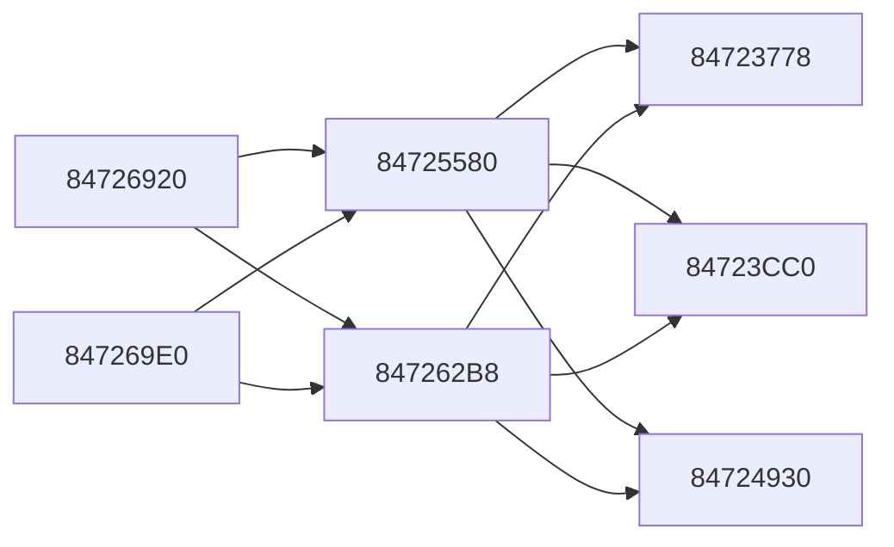

# 2026-11-01: Hot-function catalog and measured packed-vector optimization

## Question

Catalog repeatedly observed functions and optimize measured CPU work without
changing guest results. This continues the native port's performance work;
it does not assign speculative engine symbols or imply a complete frame-rate fix.

## Catalog and evidence

`docs/symbols/symbols.csv` records addresses, names and evidence. Unresolved
semantics retain `FUN_` names. `docs/symbols/hot_functions.csv` records static
instruction-comment counts, vector-operation counts, store sites, loop backedges
and direct callers. These are generated-code metadata, not sampled call counts.
Regenerate into a new output with `tools/catalog_hot_functions.py`.

| Function | Prior worker IP hits / 30 | Instruction comments | Vector comments | Packed stores |
|---|---:|---:|---:|---:|
| `84723778` | 15 | 337 | 233 | 16 |
| `84723CC0` | 6 | 362 | 249 | 16 |
| `84724930` | 5 | 603 | 414 | 16 |

**[CONFIRMED]** Read-only Ghidra verifies the entries and return-helper branches
at `84723CB8`, `84724264` and `84725298`. The first two routines loop over
descriptor-counted groups; the third has nested loops. Their vector unpack,
multiply/add, selection, pack and store operations are established. Specific
animation/skinning/geometry ownership has not been established.

Two shared callers, `84725580` and `847262B8`, are called by `84726920` and
`847269E0`. The catalog also includes `84DCB0C8`, containing the verified
`VdSwap` call used for submission timing. Save/restore helpers keep their
existing SDK-recognized names. Frequent kernel warning text is not treated as
evidence that those stubs dominate CPU execution.

## Optimization

Each hot routine contains 16 type-6 packed-vector conversions. The corrected
baseline clamps biased floating-point bit patterns component by component,
then packs three 20-bit fields and one four-bit field into 64 bits.

An integer SIMD implementation uses signed integer min/max and a positive-NaN
mask. Negative encodings clamp to minimum; positive NaNs also select minimum;
positive infinity selects maximum. Lane ordering, both destination halves,
source/destination aliasing and temporary/scratch contents are preserved.
The helper requires only the existing SSE4.1 baseline and adds no FMA, fast-math
or AVX2 requirement. It introduces no floating-point operations or FP mode changes.

`tools/optimize_codegen.py` recognizes the complete corrected emission and
creates optional fast variants of only these three functions. It retains their
original scalar bodies and rejects unknown pack shapes or site counts. Generated
duplicates remain local and ignored. Codegen timestamp preservation runs after
correction and optimization, so unchanged output remains unchanged to Ninja.

The default is `--ch2k8_vector_pack=optimized`; `baseline` restores the original
corrected bodies. `compare` randomly interleaves implementations by function call
in one run, avoiding correlation between fixed call-order parity and job size.
Dispatch occurs once per function, rather than once per vector pack.

## Correctness validation

- **[CONFIRMED]** 317,848 input vectors compare against the corrected scalar
  conversion, with both destination halves and in-place/distinct registers:
  **1,271,392 pack comparisons**. Inputs include boundaries, full random bit
  patterns, realistic biased values, NaNs, infinities and subnormals. Special
  cases run under four rounding modes with FTZ/DAZ both enabled and disabled.
  Destination, source preservation and temporary/scratch state match.
- **[CONFIRMED]** 36 complete generated-function comparisons execute both
  variants with the original generated save/restore helpers. All PPC context
  bytes and two MiB of guest memory match. Synthetic descriptors vary group
  counts and output alignment; inputs are randomized. No helper stubs replace
  the original register save/restore bodies. These are synthetic workloads,
  not snapshots of every retail game state.
- Every original scalar packed-conversion site remains checked. Duplicated
  unpack sites and all 48 fast pack sites are also covered by local checks.

## Measured results

The standalone benchmark alternates measurement order over eight trials after
warmup. Median scalar cost is approximately **2.76 ns/pack**, versus **1.68 ns**
for integer SIMD: about **39% less kernel time** on this host. Timing is recorded,
not asserted as a flaky correctness condition.

Run `20261101-014141-170-hot-compare` randomly interleaves implementations in one
Vulkan process. Opt-in `ch2k8_hot_log` aggregates calls, descriptor work counts
and whole-function wall time by thread and implementation. Seconds 60–120 give:

| Function | Baseline calls | Optimized calls | Baseline ns/work unit | Optimized ns/work unit | Reduction |
|---|---:|---:|---:|---:|---:|
| `84723778` | 181,382 | 181,976 | 307.97 | 287.06 | 6.8% |
| `84723CC0` | 90,927 | 90,752 | 303.09 | 275.51 | 9.1% |
| `84724930` | 90,933 | 90,865 | 13,816.68 | 12,319.27 | 10.8% |

The first two work units are descriptor group counts. The third counts outer
groups and has variable inner work, so its normalized result is less precise.
Randomized interleaving and closely matched total work reduce scene/ordering
bias, but this is not execution of the identical job twice. Wall time includes
preemption and probes. One-second aggregate bins may cross window boundaries;
the final partial bin can be lost on forced process termination.

Together the functions account for approximately **58.3 seconds of wall time
on one worker during this 60-second window**, confirming their importance to
the saturated worker. The mixed run's median guest submission interval is
74.967 ms; it is not a controlled whole-game speedup measurement. A black native
image at 110 seconds does not validate scene correctness for that Vulkan run.
The separate optimized-only D3D12/ROV check is recorded below.

### Optimized-only ROV validation and callback repair

The first optimized-only ROV run has a 73.117 ms median submission interval
during seconds 60–120 and captures a coherent Villanova/North Texas tip-off
scene at about 130 seconds. At about 179 seconds it reaches an unregistered
callback, `8471B0A8`. Read-only recovery verifies `li r3,0` and a tail branch
to existing `84718B80`. Extending the adjacent family audit identifies only
one further missing sibling, `8471B0B0`; both are registered. See the
[callback finding](2026-11-01-gameplay-zero-argument-callbacks.md).

The rebuilt default-optimized retry (`20261101-015316-004-hot-rov-retry`)
continues past that failure point. Native readbacks at approximately 180 and
240 seconds show coherent live Albany/Cornell play, visible HUD and ball,
clock progression from **4:34 to 3:53**, and score progression from **2–0 to
4–0**. It remains alive until deliberately stopped after about 290 seconds.
There is no new fatal entry in that bounded retry. This validates live demo
play for the observed matchup, not full-match, Legacy or save stability.

During seconds 180–240, median guest submission interval is **72.683 ms**
(13.76 submissions/s). The earlier approximately 78 ms baselines used different
scenes/settings, so this is supporting observation rather than a controlled
FPS improvement claim. The stronger optimization evidence remains the
interleaved whole-function timings and bit-exact differential tests.

Both Release builds pass. Full repository suite: **47 passed, 1 skipped**
(separate PS3 extraction absent). All 1,762 recognized inline tables still
match with no truncation/disagreement, generated fatal fallbacks remain zero,
and the expanded 21-entry callback family has no registration gaps.

## Reproduction and remaining work

Use `--ch2k8_hot_log=PATH.csv --ch2k8_vector_pack=compare`, then summarize a
window with `tools/summarize_hot_functions.py PATH.csv --start 60 --end 120`.
Disable hot logging for normal play; it is off by default. The normal frame,
output capture and Vulkan/D3D12 controls remain available.

Further candidates include the 48 byte-loop `stvlx` sites and unpack/matrix
operations. Those stores currently use volatile guest accesses and physical
alias handling; they are not widened speculatively across alignment, page or
memory-mapped boundaries. The earlier AVX2-only experiment showed no speedup.
Full-game completion, Legacy/save validation, the black UGA head and remaining
slowdown are still open. A measured hot-function gain is not a promise of the
same percentage improvement in displayed FPS.
